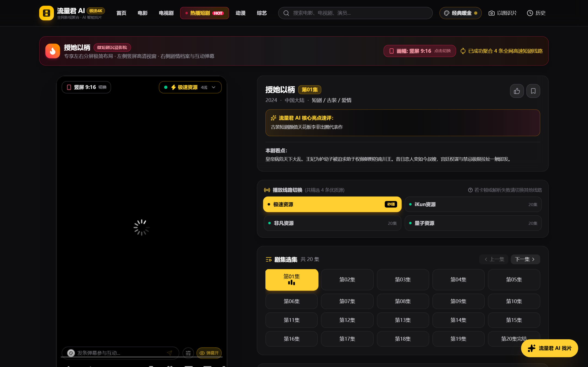
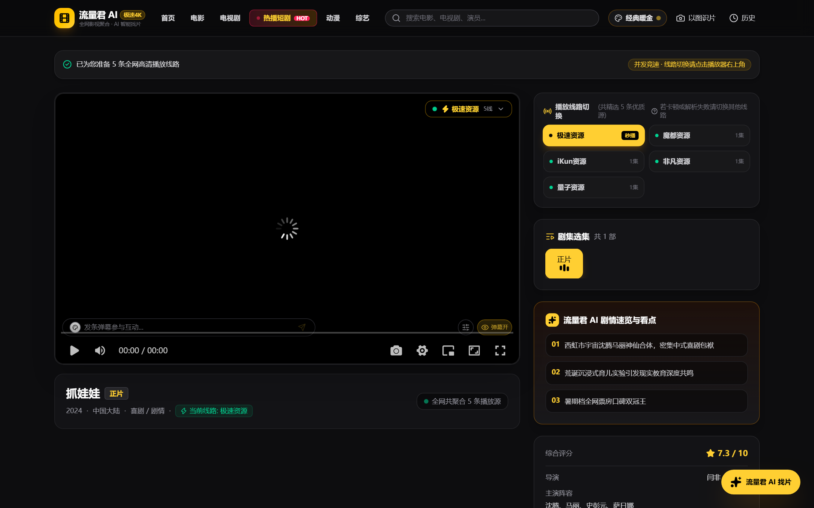

# 电影聚合 & 热播短剧平台 | DianYingJuHe

<p align="center">
  <strong>新一代高性能影视聚合与微短剧播放平台</strong><br>
  Next-Generation High-Performance Video Aggregation & Short Play Streaming Platform
</p>

<p align="center">
  🌐 <strong>在线演示 Demo:</strong> <a href="https://next.91milk.net" target="_blank">https://next.91milk.net</a>
</p>

<p align="center">
  
</p>

### 📸 界面预览 / Screenshots

| 首页全景 (Home) | 9:16 短剧专属沉浸播放页 (Short Play) |
| :---: | :---: |
|  |  |

| 16:9 电影选线播放页 (Movie Play) |
| :---: |
|  |

<p align="center">
  <a href="#简体中文">简体中文</a> •
  <a href="#english">English</a> •
  <a href="#日本語">日本語</a> •
  <a href="#部署与安装指南--installation-guide">安装指南 / Deployment</a> •
  <a href="#开源许可与引用说明--license--attribution">许可协议 / License</a>
</p>

---

## 简体中文

### 📖 项目简介
**DianYingJuHe（电影聚合）** 是一套基于 **Next.js 16 (App Router + Turbopack)** 架构开发的高性能、现代化影视聚合与微短剧交互平台。  
系统支持多源并发聚合、秒级选线起播、智能单飞防抖、自适应熔断保护、全功能弹幕互动及左右分屏沉浸式竖屏短剧播放。

### ✨ 核心特性
- **全网多源并发智能解析**：秒级并发检索各大资源站，智能去重，优先挑选超清 HLS/m3u8 极速直链。
- **高并发稳定性保障**：
  - **Singleflight（请求单飞合并）**：瞬间高并发访问同一影片仅发起 1 次上游请求，彻底防止网络连接池耗尽与上游 429 限流。
  - **内存级 LRU / TTL 缓存**：热点片源线路毫秒级直出。
  - **Circuit Breaker（自适应熔断器）**：针对持续超时的故障站自动熔断降级，0ms 跳过坏站，拒绝木桶效应。
- **微短剧沉浸体验**：
  - 针对微短剧（9:16）自动识别视频比例，支持竖屏/横屏自由切换。
  - 左右分屏交互：左侧独立视窗，右侧选集、互动与评论一体化。
- **全功能互动弹幕引擎**：
  - 支持滚动、顶端、底端弹幕，自带弹幕颜色与字号调节。
  - 轨道避让算法：弹幕安全区分布在屏幕上半区，底端弹幕悬浮抬高，彻底杜绝遮挡播放器控制栏与字幕。
  - 本地乐观上屏 + 服务端实时持久化与点赞同步。
- **现代响应式 UI**：基于 Tailwind CSS，极致深色模式与细腻毛玻璃质感，适配 PC 与移动端。

---

## English

### 📖 Overview
**DianYingJuHe** is a modern, high-performance video aggregation and short play streaming web application built with **Next.js 16 (App Router + Turbopack)** and **TypeScript**.  
It provides intelligent multi-source racing resolution, high-concurrency protection (Singleflight & Circuit Breaker), vertical/horizontal dynamic short-drama playback, and a full-featured real-time danmaku (barrage) overlay system.

### ✨ Key Features
- **Concurrent Multi-Source Aggregation**: Concurrently resolves streams across multiple video resource providers, auto-deduplicating and prioritizing fast, advertisement-free `.m3u8` direct streams.
- **Enterprise High-Concurrency Resilience**:
  - **Singleflight Request Merging**: Suppresses burst traffic for identical resources, eliminating connection pool starvation and upstream HTTP 429 rate limits.
  - **In-Memory LRU & TTL Caching**: Delivers sub-millisecond route resolution for trending titles.
  - **Site Circuit Breaker**: Auto-trips broken/slow upstream providers to bypass bad endpoints in 0ms, eliminating latency bottlenecks.
- **Dedicated Short-Drama Experience**:
  - Automatic video aspect detection (9:16 vertical vs. 16:9 widescreen) with manual toggle.
  - Split-screen layout: player view on the left, episodes list and community chat on the right.
- **Full-Featured Interactive Danmaku Overlay**:
  - Scrolling, top-fixed, and bottom-fixed barrage with color palette and font-size customization.
  - Track collision avoidance: keeps barrages strictly within safe upper zones and elevates bottom barrages above player controls.
  - Optimistic UI updates with asynchronous persistent storage and likes.
- **Responsive Dark UI**: Polished glassmorphism design optimized for desktop and mobile viewports.

---

## 日本語

### 📖 プロジェクト概要
**DianYingJuHe** は、**Next.js 16 (App Router + Turbopack)** と **TypeScript** をベースに構築された次世代の動画アグリゲーションおよびショートドラマ（微短劇）再生プラットフォームです。  
高速な複数ソース並行解析、高負荷対策（Singleflight & サーキットブレーカー）、リアルタイム弾幕システム、縦画面ショート動画プレイヤーを完備しています。

### ✨ 主な機能
- **複数配信ソースの高速並行解決**: 複数のリソースサイトを並行検索し、最適な HLS (`.m3u8`) 直リンクを優先再生。
- **高負荷・スパイク耐性**:
  - **Singleflight（リクエスト結合）**: 同一作品への同時リクエストを 1 つにまとめ、コネクション枯渇や上流の 429 レート制限を完全防止。
  - **インメモリ LRU / TTL キャッシュ**: トレンド作品の再生ルートを 0ms で超高速返却。
  - **サーキットブレーカー（自動遮断機能）**: ダウンまたは低速な外部サイトを自動検知し、0ms でスキップ。
- **縦型ショートドラマ特化 UI**:
  - 9:16（縦型）と 16:9（横型）のアスペクト比を自動認識・ワンクリック切り替え可能。
  - 左右分割レイアウト（左側にプレイヤー、右側にエピソード選択とコメント一覧）。
- **高機能インタラクティブ弾幕システム**:
  - スクロール・上部固定・下部固定弾幕、カスタムカラー・サイズピッカー対応。
  - 衝突回避アルゴリズムにより、操作ボタンや字幕との重なりを防止。
- **レスポンシブデザイン**: Tailwind CSS によるダークテーマと洗练されたグラスモーフィズム UI。

---

## 部署与安装指南 / Installation Guide

本项目提供 **4 种主流安装部署方式**，可根据实际运行环境选择最适合的方案：

### 方式一：Node.js 原生部署（推荐开发与测试）

**前置要求**：Node.js `>= 18.18.0`（推荐 `20.x` LTS），已安装 `git`。

```bash
# 1. 克隆代码仓库
git clone https://github.com/91milk/dianyingjuhe.git
cd dianyingjuhe

# 2. 安装依赖项
npm install

# 3. 环境变量配置 (可选)
cp .env.example .env.local  # 如有需要可自定义端口与网站信息

# 4. 编译构建
npm run build

# 5. 启动生产服务 (默认端口 3300)
npm run start
```
启动后在浏览器访问：`http://localhost:3300`

---

### 方式二：Docker 容器化极速部署（推荐轻量生产）

使用 Docker 可以在任何 Linux/Windows/macOS 服务器上实现环境隔离与一键运行。

#### 1. 构建 Docker 镜像
在项目根目录下执行：
```bash
docker build -t dianyingjuhe:latest .
```

#### 2. 运行容器
```bash
docker run -d \
  --name dianyingjuhe \
  --restart always \
  -p 3300:3300 \
  -v $(pwd)/data:/app/data \
  dianyingjuhe:latest
```

---

### 方式三：Docker Compose 一键编排（最简运维）

使用 Docker Compose 便于管理数据卷持久化与开机自启。

在项目目录中直接运行：
```bash
docker compose up -d
```

查看运行状态与日志：
```bash
docker compose ps
docker compose logs -f
```

---

### 方式四：Linux Systemd 服务 + Standalone 独立运行时（高性能高可用生产部署）

本项目在 `next.config.ts` 中开启了 `output: "standalone"`，生成的独立部署包体积仅几十兆，内存占用更低且无需完整 `node_modules`。

#### 1. 服务器端打包与拷贝
```bash
npm run build

# 复制静态资源到 standalone 目录
cp -r public .next/standalone/
cp -r .next/static .next/standalone/.next/
cp -r data .next/standalone/
```

#### 2. 配置 Systemd 系统守护进程
创建 `/etc/systemd/system/dianyingjuhe.service`：
```ini
[Unit]
Description=Dianyingjuhe Next.js Application
After=network.target

[Service]
Type=simple
User=www-data
WorkingDirectory=/opt/dianyingjuhe
Environment=NODE_ENV=production
Environment=PORT=3300
Environment=HOSTNAME=0.0.0.0
ExecStart=/usr/bin/node /opt/dianyingjuhe/server.js
Restart=always
RestartSec=5
StandardOutput=syslog
StandardError=syslog
SyslogIdentifier=dianyingjuhe

[Install]
WantedBy=multi-user.target
```

#### 3. 启用并启动服务
```bash
systemctl daemon-reload
systemctl enable dianyingjuhe
systemctl start dianyingjuhe
systemctl status dianyingjuhe
```

---

### 附：Nginx 反向代理与 SSL 配置示例

若需要绑定自定义域名（如 `next.91milk.net`）并开启 HTTPS 访问，推荐的 Nginx 配置如下：

```nginx
server {
    listen 80;
    server_name next.91milk.net;
    return 301 https://$host$request_uri;
}

server {
    listen 443 ssl http2;
    server_name next.91milk.net;

    ssl_certificate /etc/nginx/ssl/next.91milk.net.crt;
    ssl_certificate_key /etc/nginx/ssl/next.91milk.net.key;
    ssl_protocols TLSv1.2 TLSv1.3;

    # 静态资源强缓存优化
    location /_next/static {
        proxy_pass http://127.0.0.1:3300;
        proxy_set_header Host $host;
        expires 365d;
        access_log off;
    }

    # 主站反向代理
    location / {
        proxy_pass http://127.0.0.1:3300;
        proxy_http_version 1.1;
        proxy_set_header Upgrade $http_upgrade;
        proxy_set_header Connection 'upgrade';
        proxy_set_header Host $host;
        proxy_set_header X-Real-IP $remote_addr;
        proxy_set_header X-Forwarded-For $proxy_add_x_forwarded_for;
        proxy_set_header X-Forwarded-Proto $scheme;
        proxy_cache_bypass $http_upgrade;
    }
}
```

---

## 开源许可与引用说明 / License & Attribution

本项目遵循开放共享原则，欢迎大家学习、使用与二次开发。

### 📜 授权与使用规则
1. **允许二次改造与定制 (Modification Allowed)**：
   - 您可以自由修改、扩展代码，添加新的采集源、换肤或与现有业务系统进行深度整合。
2. **转载与引用需保留出处 (Attribution Required)**：
   - 任何个人、组织或平台在**转载、二次分发代码或公开发布派生版本**时，**必须在项目显著位置（如 README 或系统关于页）保留原作者版权信息与原项目开源仓库链接**。
3. **免责声明 (Disclaimer)**：
   - 本项目仅供技术交流与学术研究。项目中聚合的相关资源数据均来自于网络第三方接口，平台本身不存储任何未经授权的音视频文件。

```text
Copyright (c) 2026 91milk (https://github.com/91milk/dianyingjuhe)
Licensed under the MIT License.
```
